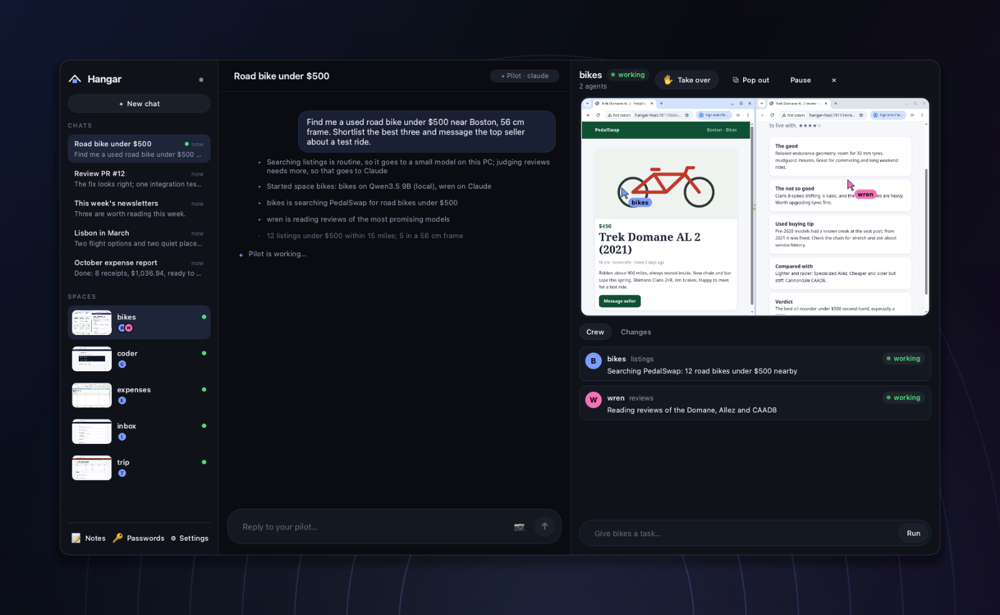
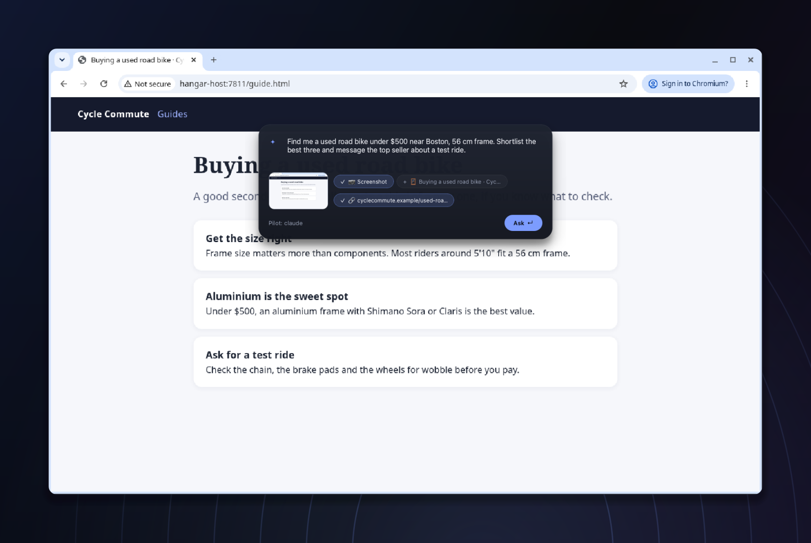
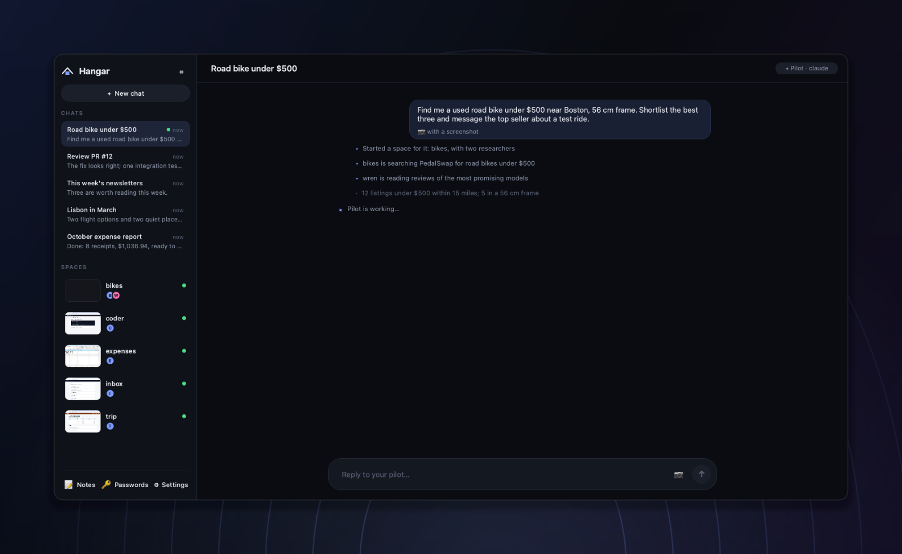
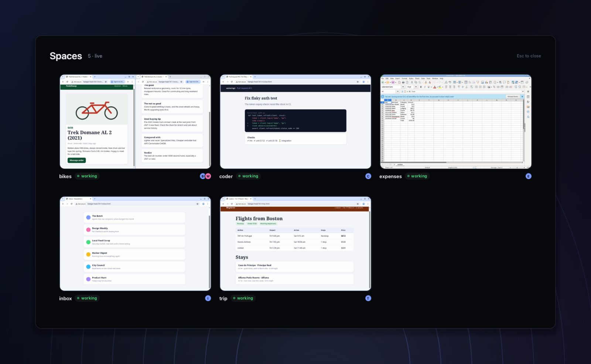
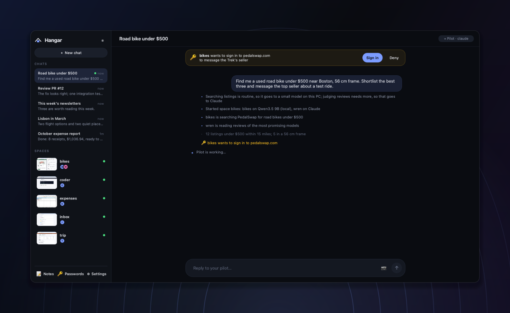
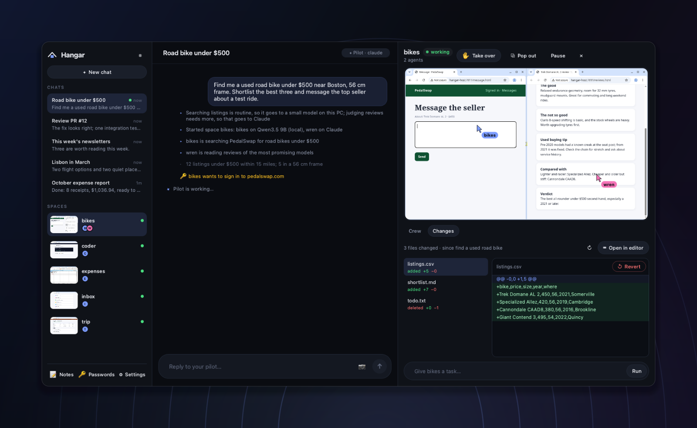
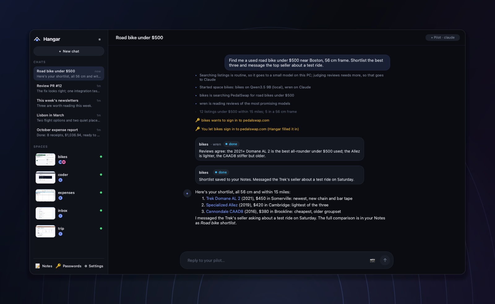
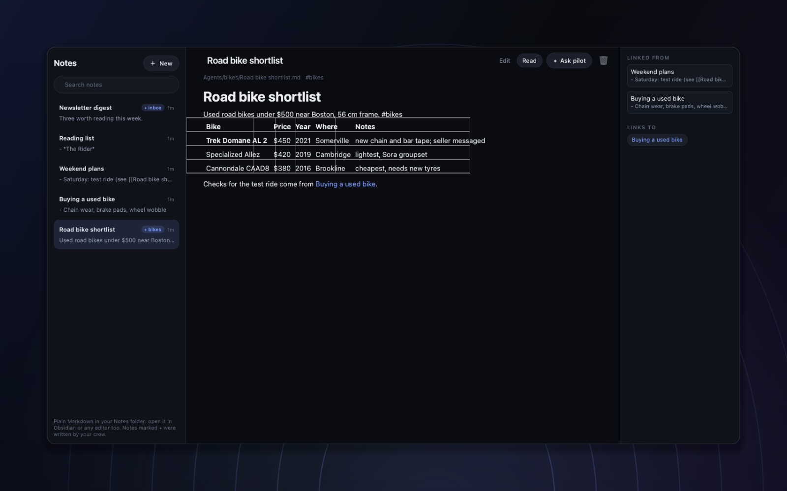

<div align="center">

# Hangar OS

**The operating system with a crew of AI agents built in.**



</div>

Most of your to-do list happens on a computer: comparing things across a
dozen tabs, sorting email, filling in spreadsheets, reviewing code, booking
travel. Hangar OS is a desktop operating system where that work can be
handed off. Alongside your own desktop, it runs a crew of AI agents, each
with **a computer of its own**: a real browser, real apps and real files on a
desktop you can watch. They use it the way you would, so there's nothing to
integrate: if you can do it on a computer, so can they.

You ask for what you need in plain words, from anywhere on the system. Your
**pilot** plans the job, puts agents on it, and keeps you posted in one
conversation. Meanwhile you get on with your day, and come back to finished
work.

Hangar OS is Fedora Kinoite (KDE Plasma) with Hangar built into the desktop:
you install it on a PC, log in, and the crew is part of the computer, in the
taskbar, the shortcuts and the notifications.

> **Status:** early. The OS image builds in CI and every part runs in
> development, but it hasn't been installed on real hardware yet
> ([what's unverified](https://github.com/js802025/hangar-os/wiki/Troubleshooting#not-yet-verified-on-real-hardware)).

## What it's like

<table>
<tr>
<td width="50%"><br>
<b>Hand it off the moment you think of it.</b> One shortcut from anywhere on the system, with a screenshot or the window you're in attached if you like. Type or speak.</td>
<td width="50%"><br>
<b>A crew takes it from there.</b> The pilot breaks the job down and gives each part the most efficient model that can do it: a small model on the machine for routine browsing, a bigger one only where judgement is needed.</td>
</tr>
<tr>
<td><br>
<b>They work the way you do.</b> Each space is a desktop of its own. Several agents can share one, each with its own mouse and keyboard.</td>
<td><br>
<b>Many jobs at once.</b> Shopping, email, code, travel and paperwork all moving at the same time, one key away, or each on a virtual desktop of its own.</td>
</tr>
<tr>
<td><br>
<b>Your accounts stay yours.</b> Agents ask before signing in anywhere. You approve, the OS fills it in, and the agent never sees the password.</td>
<td><br>
<b>Nothing happens behind your back.</b> Watch any agent, take over its desktop, and see (and undo) every change it made.</td>
</tr>
<tr>
<td><br>
<b>Come back to finished work.</b> One answer, with the work done. The notification takes you straight to it.</td>
<td><br>
<b>It all adds up.</b> What your crew finds goes into your notes: plain Markdown files that also open in Obsidian.</td>
</tr>
</table>

## What's in the box

- **Hangar:** your conversations with the pilot, your spaces live alongside,
  review of everything agents change, and an overview of every space at once.
- **Ask from anywhere:** system-wide shortcuts to ask the pilot, with a
  screenshot or the window you're in. Voice input is transcribed on the
  machine.
- **Notes, Passwords, Accounts, Models, Settings:** native apps for your
  notes, a password vault agents can borrow logins from (with your OK), your
  AI subscriptions, and AI models that run on the machine itself.
- **A normal KDE desktop** around it: browser, files, Discover, and Zed for
  reviewing code.
- **Image-based and atomic:** updates swap the whole system at once and can
  be rolled back with one command.

## Built to be trusted

Agents act on your behalf, so the OS is designed around keeping them in
their lane:

- **Each agent has its own computer.** Agents run in containers on your
  machine, each with its own hidden desktop that never touches your screen,
  mouse or keyboard. They can use AI models that run on the machine itself.
- **They see only what you share.** No access to your files except folders
  you hand to a space. Hangar refuses to share your home folder, SSH keys,
  keyrings or cloud credentials.
- **Sign-ins go through you.** Passwords live in an encrypted vault; agents
  ask, you approve, the OS types it in. AI subscriptions sign in through each
  company's official login, and Hangar never sees those passwords.
- **No more model than the job needs.** The pilot matches each agent to the cheapest model
  that can do its part, so routine work stays free and private on the machine.
- **Limits that are enforced, not requested.** Which models the pilot may
  use, how many agents can run, which websites a space can reach: the system
  enforces these, whatever an agent says.
- **Everything can be undone.** Each task starts with a snapshot of the
  workspace: review the changes file by file, revert one, or roll back all of it.

## Get Hangar OS

You build your own copy of the OS in GitHub Actions (no build machine
needed), write it to a USB stick, and install it on any x86_64 PC. The
**[installation guide](https://github.com/js802025/hangar-os/wiki/Installing-Hangar-OS)**
walks through it, and the first login runs a setup wizard that connects your
AI accounts and picks models that fit the hardware.

### From another device

Hangar OS is meant to be used at the machine itself, but you can keep up from
elsewhere: phone notifications when work is done (ntfy, Slack or Telegram),
and a web version for checking on spaces and approving sign-ins from your
phone or another computer on your network. See
[From another device](https://github.com/js802025/hangar-os/wiki/From-another-device).

### Developing on a Mac

Every part of Hangar also runs on a Mac with Docker, for development:
`make images && uv sync --extra apps`, then `uv run hangar open`. See
[development.md](docs/development.md).

### From your own agent

Bring your own client: the `hangar` plugin lets Claude Code (or any MCP
client) hand Hangar computer work, on a Linux desktop or a Mac VM, while you
watch it in Hangar's app.

```
/plugin install hangar --marketplace js802025/hangar-os
```

See [reference.md](docs/reference.md#hangar-for-your-other-agents-hangar-mcp).

## Documentation

| | |
|---|---|
| **[Wiki](https://github.com/js802025/hangar-os/wiki)** | using Hangar OS: installing, first boot, the apps, shortcuts, privacy, troubleshooting |
| **[Reference](docs/reference.md)** | the CLI, teams and the pilot, the vault, network allowlists, the daemon API, agent tools |
| **[Development](docs/development.md)** | how it fits together, dev setup, tests, repo layout, the demo video |

## Roadmap

**Done:** hidden desktops and agent tools (M1–M2) · accounts, local models
(M3) · background service and notifications (M4) · native apps and setup
wizard (M5–M6) · snapshots, network allowlists, app flavors (M7) · the
installable OS image (M8) · teams of agents and the pilot (M9) · ask from
anywhere (M10) · chat-first Hangar, review, Notes, spaces on their own
desktops (M11).

**Next:** install on real hardware and fix what it finds · an NVIDIA variant
of the image · an arm64 build, to try the whole OS in a VM.
